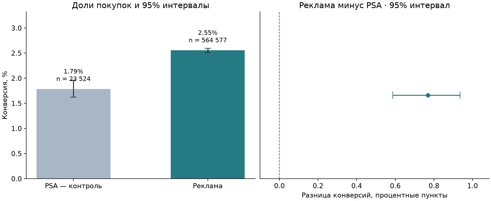

# Помогает ли реклама получать больше покупок?

Учебный проект по продуктовой аналитике: **Python, SQL, PostgreSQL и статистика**.

Компания показывает одним пользователям рекламу продукта, другим — нейтральные объявления PSA. Хочется понять, различается ли доля покупок и достаточно ли результата, чтобы продолжать кампанию.

## Что получилось

В файле 588 101 пользователь. Конверсия рекламной группы — **2,55%**, PSA — **1,79%**. Наблюдаемая разница — **+0,77 процентного пункта**, 95% доверительный интервал — **от +0,59 до +0,94 п.п.** Относительное различие — около **43%**. Это не 43 процентных пункта.



Различие статистически значимо при предпосылках теста, но этого недостаточно для решения «масштабируем»: в наборе нет стоимости рекламы, выручки, маржи и первичного протокола распределения групп. Поэтому результат поддерживает дальнейшую проверку кампании, а не обещание роста прибыли.

## Что сделано

- Проверены пропуски, повторяющиеся ID, типы и допустимые значения. Все исходные пользователи сохранены; удалён только технический индекс CSV.
- Рассчитаны конверсии, абсолютная и относительная разница, двусторонний z-тест двух долей и доверительный интервал Newcombe–Wilson.
- Код проверен на искусственных A/A-данных. Отдельно рассчитан пример размера будущего теста при заданных MDE и мощности.
- Данные загружены в PostgreSQL. Есть ограничения, журнал успешных/неуспешных загрузок и повторный запуск без дублей по SHA256 файла.
- Подготовлены шесть SQL-вопросов с JOIN, GROUP BY, `SUM OVER`, `DENSE_RANK`, накопительным итогом и `LAG`.
- Есть локальный HTML-отчёт: после скачивания репозитория откройте `results/dashboard.html`. Он использует только локальные файлы.

## Данные

Для анализа используется файл `marketing_AB.csv`: 588 101 пользователь. Исходный CSV хранится локально в `data/raw/` и не включён в Git.

Единица наблюдения — пользователь. `converted` — результат покупки; `test group` — группа. `total ads`, `most ads day` и `most ads hour` описывают показы, а не обязательно характеристики пользователя до воздействия. Сумм денег и календарной последовательности событий нет.

## Запуск анализа

Python 3.11+:

```powershell
python -m venv .venv
.\.venv\Scripts\Activate.ps1
python -m pip install -r requirements.txt
python scripts/download_data.py --csv "путь/к/marketing_AB.csv"
python -m src.analysis
python -m unittest discover -s tests -v
jupyter lab
```

Откройте `notebooks/campaign-analysis.ipynb`. Тетрадка сохранена с выполненными ячейками, поэтому результаты видны и без локального запуска. После изменения входных данных сначала пересчитайте `python -m src.analysis`, чтобы обновить графики.

Скрипт подготовки копирует указанный CSV в папку проекта и проверяет его структуру. Если файл уже подготовлен, повторный вызов `python scripts/download_data.py` проверит локальную копию без обращения к сети.

## PostgreSQL

Можно использовать установленный PostgreSQL или Docker Compose:

```powershell
Copy-Item .env.example .env
# Укажите свой локальный пароль в .env; Docker использует порт 55433.
docker compose up -d --wait
python -m src.database --init
python -m src.database
```

Для локального сервера создайте отдельную базу с именем `marketing_ab_*` и заполните `.env`. Второй запуск с тем же файлом вернёт `skipped`. На ноутбуке автора проверка выполнена на установленном PostgreSQL, а не через Docker.

Таблицы: `campaign.loads` — журнал, `campaign.users` — проверенные данные. Витрины: `v_group_metrics`, `v_exposure_summary`. Их можно подключить в Power BI; готовый PBIX в этом проекте не создавался.

При ошибке загрузки данные откатываются, а запись `failed` остаётся в журнале. В публичный проект не попадают пароли и `.env`.

## Почему вывод осторожный

Группы отличаются по размеру примерно в 24 раза. Это не доказывает ошибку рандомизации: плановая пропорция неизвестна. Нет оснований проверять её против 50/50.

Рандомизация и окно наблюдения не подтверждены первичным протоколом. Причинная интерпретация возможна только при дополнительных предпосылках. «Лучший день» и «лучшее число показов» нельзя выбирать как причинную рекомендацию из этих данных. CUPED и uplift-модель здесь не добавлены: нет надёжно определённых предэкспериментальных признаков.

Это ретроспективный учебный разбор, не проведённый автором эксперимент и не работа для X5 или Т-Банка. В подготовке кода и документации использованы AI-инструменты.

## Что проверено

10 тестов статистики и валидации; сверка z-теста с независимым расчётом через χ²; выполнение тетрадки; сравнение SQL-агрегатов с Pandas; повторная загрузка без дублей; запись ошибки и откат некорректной партии. Числовой протокол проверки БД — [здесь](results/database-verification.json).
